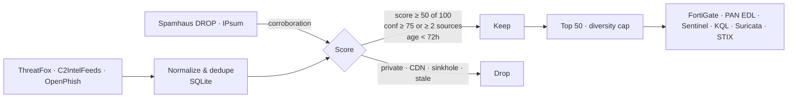

> A short, curated blocklist of **active, high-confidence** malicious infrastructure (C2, malware delivery, phishing), with ready-to-import files for firewalls, EDR/XDR and SIEM/SOAR platforms. It is regenerated every 2 hours.

<b>📘 <a href="https://mhearsh.github.io/threat-intel-feed/guide/IOC-Feed-Integration-Guide.pdf">Integration guide (PDF)</a> · <a href="https://mhearsh.github.io/threat-intel-feed/guide/GUIDE.md">Integration guide (Markdown)</a> · <a href="https://mhearsh.github.io/threat-intel-feed/">Feed index</a></b>

## At a glance
| | |
|---|---|
| **IOC types** | IPv4 addresses, domains (FQDN), URLs (no scheme), file hashes (SHA-256, SHA-1, MD5) |
| **Score** | 0–100; only **≥ 50** is published. Bands: **critical 90–100 · high 75–89 · medium 50–74** |
| **Update frequency** | Every 2 hours (commit only when data changes); entries expire after 30 days |
| **Formats** | Plain text (one per line), vendor CSV/JSON, STIX 2.1 |
| **Platforms** | Palo Alto, FortiGate, Check Point, Cisco FMC, Sophos, Suricata · Defender, CrowdStrike, SentinelOne, ESET, Trend Vision One, Cortex XDR · Sentinel, Splunk ES, Wazuh, MISP/OpenCTI |
| **Base URL** | `https://mhearsh.github.io/threat-intel-feed/feeds/` (raw fallback: `https://raw.githubusercontent.com/mhearsh/threat-intel-feed/main/feeds/<path>`) |

## Table of contents
- [At a glance](#at-a-glance)
- [Why this feed](#why-this-feed)
- [Methodology](#methodology)
- [Quick start](#quick-start)
- [Files](#files)
- [Score scale](#score-scale)
- [Today's stats](#todays-stats)
- [FAQ](#faq)
- [Reporting false positives](#reporting-false-positives)
- [Sources and licenses](#sources-and-licenses)
- [Disclaimer](#disclaimer)

## Why this feed
- **Signal, not volume.** You get 20–50 indicators per run instead of millions. Each one is tied to a named family or C2 framework and is corroborated or high-confidence.
- **Freshness first.** Indicators first seen in the last 6–24h are ranked highest, and anything older than 72h falls out.
- **Ready to import.** Native formats for FortiGate, Palo Alto, Sentinel/Defender, Suricata and STIX 2.1, with stable URLs.
- **Context included.** Every IOC carries its family, a context line, MITRE ATT&CK techniques and its sources.

## Methodology

See [docs/methodology.md](docs/methodology.md) for the full scoring model.

## Quick start
Full step-by-step guide for every platform: **[Integration guide](https://mhearsh.github.io/threat-intel-feed/guide/GUIDE.md)** ([PDF](https://mhearsh.github.io/threat-intel-feed/guide/IOC-Feed-Integration-Guide.pdf)). Base URL: `https://mhearsh.github.io/threat-intel-feed/feeds/`.

| Platform | Feed URL(s) |
|---|---|
| **Palo Alto NGFW** (EDL) | [`edl-ip.txt`](https://mhearsh.github.io/threat-intel-feed/feeds/firewall/paloalto/edl-ip.txt) · [`edl-domain.txt`](https://mhearsh.github.io/threat-intel-feed/feeds/firewall/paloalto/edl-domain.txt) · [`edl-url.txt`](https://mhearsh.github.io/threat-intel-feed/feeds/firewall/paloalto/edl-url.txt) |
| **FortiGate** (Threat Feeds) | [`ip.txt`](https://mhearsh.github.io/threat-intel-feed/feeds/firewall/fortinet/ip.txt) · [`domain.txt`](https://mhearsh.github.io/threat-intel-feed/feeds/firewall/fortinet/domain.txt) · [`url.txt`](https://mhearsh.github.io/threat-intel-feed/feeds/firewall/fortinet/url.txt) · [`hash-sha256.txt`](https://mhearsh.github.io/threat-intel-feed/feeds/firewall/fortinet/hash-sha256.txt) |
| **Check Point** (Custom Intelligence Feeds) | [`ioc-feed.csv`](https://mhearsh.github.io/threat-intel-feed/feeds/firewall/checkpoint/ioc-feed.csv) (native format; IP, domain, URL, MD5, SHA1, SHA256) |
| **Cisco Secure Firewall / FMC** | [`ip.txt`](https://mhearsh.github.io/threat-intel-feed/feeds/firewall/cisco/ip.txt) + [`.md5`](https://mhearsh.github.io/threat-intel-feed/feeds/firewall/cisco/ip.txt.md5) · [`url.txt`](https://mhearsh.github.io/threat-intel-feed/feeds/firewall/cisco/url.txt) + [`.md5`](https://mhearsh.github.io/threat-intel-feed/feeds/firewall/cisco/url.txt.md5) |
| **Sophos Firewall** | [`ip.txt`](https://mhearsh.github.io/threat-intel-feed/feeds/firewall/sophos/ip.txt) · [`domain.txt`](https://mhearsh.github.io/threat-intel-feed/feeds/firewall/sophos/domain.txt) · [`url.txt`](https://mhearsh.github.io/threat-intel-feed/feeds/firewall/sophos/url.txt) |
| **Suricata** | `suricata-update add-source tif https://mhearsh.github.io/threat-intel-feed/feeds/firewall/suricata/suricata.rules` |
| **Microsoft Defender for Endpoint** | [`files-001.csv`](https://mhearsh.github.io/threat-intel-feed/feeds/edr/microsoft-defender/files-001.csv) · [`network-001.csv`](https://mhearsh.github.io/threat-intel-feed/feeds/edr/microsoft-defender/network-001.csv) (≤500 rows per file, more files `-002`… when needed) · [`hunt.kql`](https://mhearsh.github.io/threat-intel-feed/feeds/edr/microsoft-defender/hunt.kql) |
| **CrowdStrike Falcon** (API helper) | [`iocs-api.csv`](https://mhearsh.github.io/threat-intel-feed/feeds/edr/crowdstrike/iocs-api.csv): IOC API fields for FalconPy / PSFalcon. Falcon has no documented native CSV import. |
| **SentinelOne** | [`iocs.json`](https://mhearsh.github.io/threat-intel-feed/feeds/edr/sentinelone/iocs.json), ready-to-POST body for the Threat Intelligence IOC API |
| **ESET PROTECT** | [`sha256.txt`](https://mhearsh.github.io/threat-intel-feed/feeds/edr/eset/sha256.txt) · [`sha1.txt`](https://mhearsh.github.io/threat-intel-feed/feeds/edr/eset/sha1.txt) |
| **Trend Vision One** | [`suspicious-objects.csv`](https://mhearsh.github.io/threat-intel-feed/feeds/edr/trendmicro/suspicious-objects.csv) |
| **Cortex XDR** | [`iocs.csv`](https://mhearsh.github.io/threat-intel-feed/feeds/edr/cortex-xdr/iocs.csv) |
| **Microsoft Sentinel** | [`stix21-objects.json`](https://mhearsh.github.io/threat-intel-feed/feeds/siem-soar/microsoft-sentinel/stix21-objects.json) (TI *Import using a file*, JSON array template) · [`stix21.json`](https://mhearsh.github.io/threat-intel-feed/feeds/siem-soar/microsoft-sentinel/stix21.json) (STIX bundle) · [`watchlist.csv`](https://mhearsh.github.io/threat-intel-feed/feeds/siem-soar/microsoft-sentinel/watchlist.csv) |
| **Splunk ES** | [`ip_intel.csv`](https://mhearsh.github.io/threat-intel-feed/feeds/siem-soar/splunk/ip_intel.csv) · [`domain_intel.csv`](https://mhearsh.github.io/threat-intel-feed/feeds/siem-soar/splunk/domain_intel.csv) · [`file_intel.csv`](https://mhearsh.github.io/threat-intel-feed/feeds/siem-soar/splunk/file_intel.csv) · [`http_intel.csv`](https://mhearsh.github.io/threat-intel-feed/feeds/siem-soar/splunk/http_intel.csv) |
| **Wazuh** (CDB lists) | [`cdb-ip.txt`](https://mhearsh.github.io/threat-intel-feed/feeds/siem-soar/wazuh/cdb-ip.txt) · [`cdb-domain.txt`](https://mhearsh.github.io/threat-intel-feed/feeds/siem-soar/wazuh/cdb-domain.txt) · [`cdb-sha256.txt`](https://mhearsh.github.io/threat-intel-feed/feeds/siem-soar/wazuh/cdb-sha256.txt) |
| **Generic** (MISP, OpenCTI, QRadar, XSOAR, pfSense…) | [`ip.txt`](https://mhearsh.github.io/threat-intel-feed/feeds/generic/txt/ip.txt) · [`domain.txt`](https://mhearsh.github.io/threat-intel-feed/feeds/generic/txt/domain.txt) · [`url.txt`](https://mhearsh.github.io/threat-intel-feed/feeds/generic/txt/url.txt) · [`sha256.txt`](https://mhearsh.github.io/threat-intel-feed/feeds/generic/txt/sha256.txt) · [`iocs.csv`](https://mhearsh.github.io/threat-intel-feed/feeds/generic/csv/iocs.csv) · [`stix21.json`](https://mhearsh.github.io/threat-intel-feed/feeds/generic/stix/stix21.json) |

More: [docs/integrations.md](docs/integrations.md).

## Files
| Path | Description |
|---|---|
| `feeds/generic/` | One type per file: `txt/` (ip, domain, url, sha256, sha1, md5 + `.md5` checksums), `csv/iocs.csv` (all types, **not** defanged), `csv/file-hashes.csv`, `stix/stix21.json` |
| `feeds/firewall/<vendor>/` | Palo Alto, Fortinet, Check Point, Cisco, Sophos, Suricata |
| `feeds/edr/<vendor>/` | Microsoft Defender, CrowdStrike, SentinelOne, ESET, Trend Micro, Cortex XDR |
| `feeds/siem-soar/<vendor>/` | Microsoft Sentinel, Splunk, Wazuh |
| `reports/` | Human-readable, defanged: `top-iocs.csv`, `blocklist-defanged.txt` |
| `latest/` | **Compatibility mirror**: the original filenames (`fortigate-ip-feed.txt`, `paloalto-edl-*.txt`, `defender-indicators.csv`, …), kept online |
| `archive/YYYY-MM-DD/` | Daily snapshots |
| `scripts/` | `build_feeds.py` (builds `feeds/`), `validate_feeds.py` (format checks run before every commit) |
| `stats.json` | Machine-readable stats (drives the badges) |

Raw fallback for any path: `https://raw.githubusercontent.com/mhearsh/threat-intel-feed/main/<path>`.

## Score scale
Every IOC gets a **score from 0 to 100** (`score` and `band` columns in the CSVs, `confidence` and a `band:` label in STIX). Only scores of 50 and above are published.

| Score | Band | Suggested action |
|---|---|---|
| 90–100 | critical | Block |
| 75–89 | high | Block |
| 50–74 | medium | Alert / hunt |

Details: [docs/methodology.md](docs/methodology.md#score-scale).

## Today's stats
_Last update: 2026-10-25 09:27 UTC. 50 IOCs (ip: 14, sha256: 12, domain: 12, url: 12); 45 first seen under 6h ago. File-hash feed: 411 SHA-256 · 76 SHA-1 · 77 MD5._

| # | IOC (defanged) | Type | Family | Score | Band | ATT&CK |
|---|---|---|---|---|---|---|
| 1 | `161[.]248[.]179[.]115` | ip | NjRAT | 83 | high | T1071, T1105 |
| 2 | `64[.]89[.]161[.]138` | ip | AsyncRAT | 83 | high | T1071, T1105 |
| 3 | `85[.]11[.]167[.]7` | ip | Unknown malware | 83 | high | T1071, T1105 |
| 4 | `94[.]154[.]43[.]68` | ip | Mirai | 83 | high | T1071, T1105 |
| 5 | `89[.]32[.]41[.]146` | ip | Potassium | 77 | high | T1071, T1105 |
| 6 | `149[.]104[.]31[.]151` | ip | Cobaltstrike | 77 | high | T1071, T1105 |
| 7 | `192[.]255[.]248[.]153` | ip | Cobaltstrike | 77 | high | T1071, T1105 |
| 8 | `061addb88053fdbe4b1fee7ad6d05082b1007ef072cd8dbcc0d934b25f2b` | sha256 | AMOS | 74 | medium | T1071, T1105 |
| 9 | `13[.]202[.]120[.]94` | ip | AdaptixC2 | 74 | medium | T1071, T1105 |
| 10 | `15[.]164[.]241[.]232` | ip | Cobalt Strike | 74 | medium | T1071.001, T1105, T1059 |
| 11 | `1a1bb5d172553a78f4149c581509207eaa0838fbc66e456039d1ff4b65c0` | sha256 | AMOS | 74 | medium | T1071, T1105 |
| 12 | `1bb35f3e1bc945ff547abda48bbb1c943aacf2e13521f188a8a747579937` | sha256 | AMOS | 74 | medium | T1071, T1105 |
| 13 | `1cca4154bff749992d0e8b7255038242840c7a06744a4280a6cbd168b8d0` | sha256 | AMOS | 74 | medium | T1071, T1105 |
| 14 | `3535793b9d28ddb012cda5e793b78c9da4b533017881ff32502c5a6e3b69` | sha256 | AMOS | 74 | medium | T1071, T1105 |
| 15 | `38[.]240[.]48[.]153` | ip | Quasar RAT | 74 | medium | T1071, T1105 |

## FAQ
**How often does it update?** Every 2 hours. A commit is made only when the data changes. 
**Why so few entries?** On purpose. The list is tuned for blocking with a low false-positive rate. 
**Are the values defanged?** Only in the `top-iocs.csv` and `blocklist-defanged.txt` files. The platform files contain live values so they can be imported directly. 
**Can I use it commercially?** Our data is CC BY 4.0, but Spamhaus DROP-derived corroboration is non-commercial. See [LICENSE](LICENSE).

## Reporting false positives
Open a [False positive issue](../../issues/new?template=false-positive.yml) with the indicator and your evidence. Confirmed entries are allow-listed in the next run.

## Sources and licenses
| Source | License / terms |
|---|---|
| [abuse.ch ThreatFox](https://threatfox.abuse.ch) | CC0 1.0 |
| [Spamhaus DROP](https://www.spamhaus.org/drop/) | Free for non-commercial use (Spamhaus terms) |
| [OpenPhish Community](https://openphish.com) | Free community feed, attribution, no resale |
| [C2IntelFeeds](https://github.com/drb-ra/C2IntelFeeds) | Public feed, attribution |
| [IPsum](https://github.com/stamparm/ipsum) | Unlicense |
| [Curated](curated/) | Manually added indicators listed on official sources only (vendor advisories, CISA, national CERTs); each entry links its source |

## Changelog
Full history: [CHANGELOG.md](CHANGELOG.md).

- **2026-10-24:** new `feeds/` layout (generic + per-vendor folders), feeds served from GitHub Pages, new vendor formats (Check Point, Cisco `.md5`, Trend Vision One, Cortex XDR, SentinelOne, Splunk, Wazuh), Defender split into ≤500-row files, separate `url.txt` / `domain.txt`, generic non-defanged `iocs.csv`. `latest/` stays as a compatibility mirror.
- **2026-10-24:** new file-hash feed (SHA-256 / SHA-1 / MD5 lists, Defender and CrowdStrike import CSVs, STIX `file:hashes`).
- **2026-10-24:** scores are now on a documented 0–100 scale with bands (breaking for consumers of `score`/`confidence`); the Palo Alto URL EDL no longer contains bare IPs or trailing `/` (IP hosts moved to the IP EDLs); drop CSVs no longer start with a `#` comment line.

## Disclaimer
This feed is provided **as is**, without warranty. Indicators can go stale or produce false positives, for example on reassigned shared infrastructure. Validate before you block in production. Never browse to the listed indicators.
